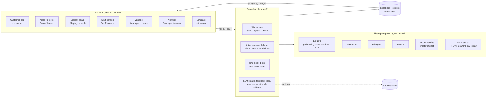

# BranchFlow

Intelligent Branch Service Load & Customer Experience Optimizer, a hackathon demo for the TCS problem statement.
`CLAUDE.md` is the build spec.

**Core loop:** predict load → detect bottleneck → recommend action → manager accepts → system executes → wait drops.

**Stack:**
- Next.js 14 (App Router, TypeScript), Tailwind, shadcn/ui, Recharts
- Supabase (Postgres + Realtime)
- Anthropic API, with a rule-based fallback for every call
- Vitest

## Architecture



- **The numbers come from deterministic code.** Forecasts, Erlang C, ETAs, alerts and recommendation impact are all
  computed in `lib/engine` (impact = re-run the ETA projection with the action applied). The LLM only classifies the
  intake conversation, tags feedback, and rephrases explanations. If it fails, the rule-based version is shown.
- **Realtime.** Screens subscribe to Supabase `postgres_changes` and refetch. A 3–5 s poll is kept as a safety net.
- **Sim clock.** Every screen runs on `sim_state` time (`lib/clock.ts`), so the simulator can fast-forward the whole
  branch day.

## Setup

```bash
npm install
cp .env.local.example .env.local      # fill in the Supabase + DB values
npm run db:migrate                    # applies supabase/migrations/0001..0003
npm run db:seed                       # synthetic data -> /data/*.csv + DB (truncates everything)
npm run dev                           # http://localhost:3000
```

`.env.local` needs:
- `NEXT_PUBLIC_SUPABASE_URL`: the project URL. A pasted `/rest/v1/` suffix is tolerated.
- `NEXT_PUBLIC_SUPABASE_ANON_KEY` and `SUPABASE_SERVICE_ROLE_KEY`.
- `DATABASE_URL`: the **Session pooler** URI.
- `ANTHROPIC_API_KEY`: optional, and the account needs credits. Without it the intake uses keyword rules and
  category chips.

Checks: `npm test`, `npm run typecheck`, `npm run lint`, `npm run build`.

## How to run the demo (≈5 minutes)

1. **Simulator** (`/simulator`): **Reset day**, then press **60×**. Keep this tab open, because it drives the bots.
   Open the display board, kiosk and manager from the side panel.
2. **Customer** (`/customer`):
   1. Sign in with any name, a mobile number and OTP `1234`.
   2. Type "my atm card was stolen" (or tap a chip).
   3. Your plan shows the online option, the documents checklist and the best time to visit.
   4. Book an appointment: branches are ranked by distance + wait, and the slot grid is coloured by forecast, with a
      ★ on the least crowded slot. Or tick "I'm at the branch" for a walk-in token and a live tracker.
3. **Kiosk** (`/kiosk/BR01`):
   1. Tap a service and add a mobile number (optional) → token + ETA + SMS on the phone panel. **Print slip** works.
   2. **I have an appointment** → `9876543210` checks in today's demo booking.
4. **Display** (`/display/BR01`): tap *enable sound*. New calls chime and are announced twice. A counter number
   appears only when the token is called.
5. **Staff** (`/staff/BR01-C1`, PIN `1101`):
   1. In the simulator, flip that counter to **human**.
   2. **Call next** shows *Why this customer*.
   3. Then start, complete, transfer, park, add a service, book a follow-up, or escalate.
6. **Simulator → Salary-day rush** (and **Staff unplanned break**). In the **manager** view (`/manager/BR01`,
   PIN `1100`), alerts appear with numbers in the "why".
7. **Recommendations** tab → **Accept** "Open Counter 7 (Suresh)". The counter opens and the Quick/Standard waits
   drop on every screen.
8. **Simulator → Before vs after**: the same day replayed as FIFO vs BranchFlow, with a KPI table and a
   wait-by-hour chart. Tick "salary-day volume" for a harsher day.
9. **Forecast** tab: hourly forecast vs actual, Erlang C needed vs rostered, *Explain an hour*, and backtest MAPE
   (≈6% daily).
10. **Insights** and **Network** views: CSAT, topics, deflection, misrouting and staff handle times; the branch map
    and staff-lending suggestions.

## Demo logins

No real auth. Staff and managers enter a 4-digit demo PIN; the role picker shows it as a hint.

| Branch | Profile | Manager PIN | Staff PINs |
|---|---|---|---|
| BR01 MG Road | Urban business (lunch peak) | 1100 | 1101–1107 |
| BR02 Whitefield | Residential (morning + evening) | 2200 | 2201–2206 |
| BR03 Hoskote | Semi-urban (Wednesday market day) | 3300 | 3301–3305 |
| BR04 Jayanagar | Senior-heavy (pension days) | 4400 | 4401–4406 |
| BR05 Malleshwaram | College area (Quick-heavy, start of month) | 5500 | 5501–5505 |

Staff PIN `<b><b>0<n>` belongs to counter `n` (e.g. 1104 = Anita Desai, counter 4, BR01). The all-skills officer at
each branch starts **offline** (back office). That is the lever the "Open counter" recommendation pulls.

## Project layout

```
app/                         pages + /api route handlers
components/                  shadcn/ui, phone panel (mock SMS), service icons
lib/engine/                  pure engine: queue, scoring, calendar, forecast, erlang, alerts, recommend, replay, compare
lib/server/                  workspace (DB load/flush), actions, intel (tick/accept), sim, llm, intake
lib/client/live.ts           realtime hook, sim clock hook, fetch helper
lib/data/                    catalog (18 services), branches/staff, profiles, holidays
scripts/                     generate.ts (synthetic data), migrate.ts
supabase/migrations/         0001 schema, 0002 live/views, 0003 event branch_id
data/                        generated CSVs
```

## Data Considerations

- **All data is synthetic.** Branches, staff names and visits are generated. "Sample Demo Bank" procedures are
  illustrative only and are not any real bank's process.
- **No sensitive identifiers.**
  - The schema has no columns for account numbers, Aadhaar, PAN or card numbers.
  - Mobiles are stored masked (`98xxxxxx21`), plus a salted SHA-256 hash used only for kiosk check-in lookup.
  - The chat masks Aadhaar-, PAN-, card- and account-like numbers before anything is sent to the server or the LLM,
    and warns the customer.
- **History** (90 days, 5 branches, about 51k visits and 14k feedback rows):
  - Arrivals are Poisson per hour per category, built from the profile curve × day-of-week × the section 9.1
    factors (salary 1.4, month end 1.2, post-holiday 1.3, pension day 1.3).
  - Rosters include about 8% absences and staggered breaks.
  - Handle times are lognormal.
  - **Waits come from replaying each day through the same scoring the live engine uses.**
  - Feedback is correlated with wait, with templated English/Hinglish comments.
- **Forecast.** Base rates are the mean of de-factored history (each day ÷ its factors), so factors aren't double
  counted. The backtest trains only on days before the 14-day test window.
- **Before/after comparison assumptions** are listed on screen. Both runs use the same arrivals and roster. "After"
  adds BranchFlow routing, the officer opened around the forecast peak, and a 25% digital-nudge uptake on app-doable
  Quick walk-ins.
- **Deterministic.** The same `--seed` and `--end` always produce the same data.
